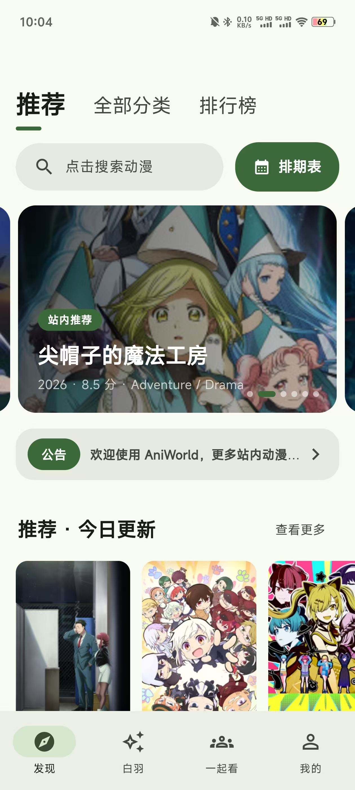
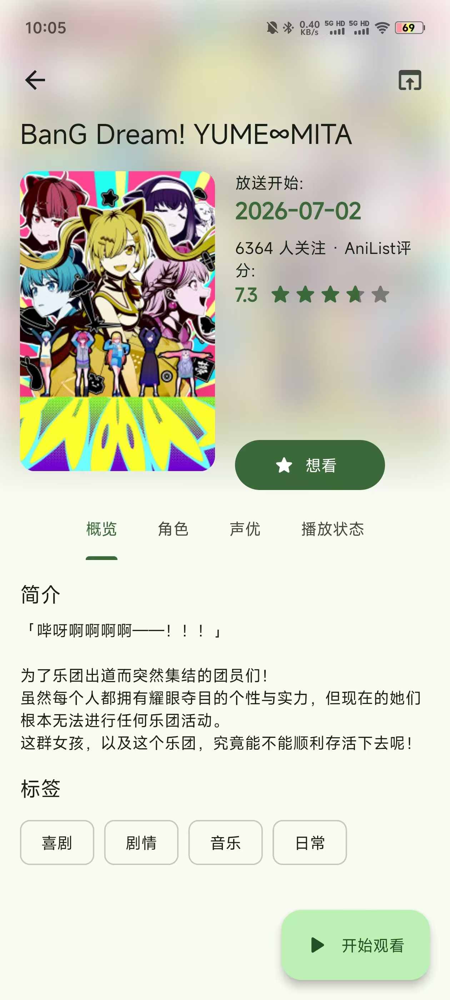
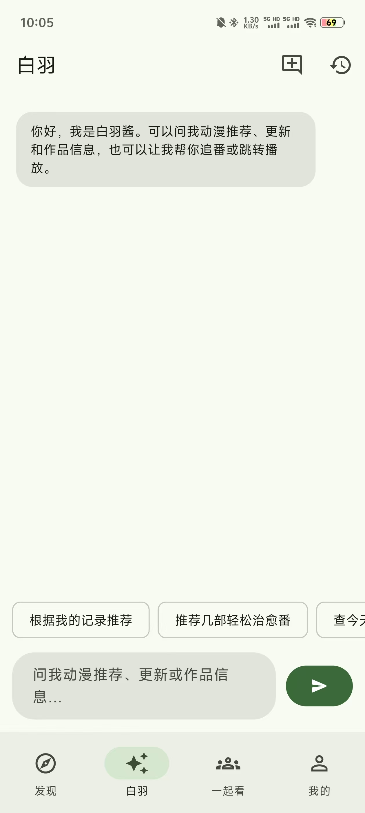
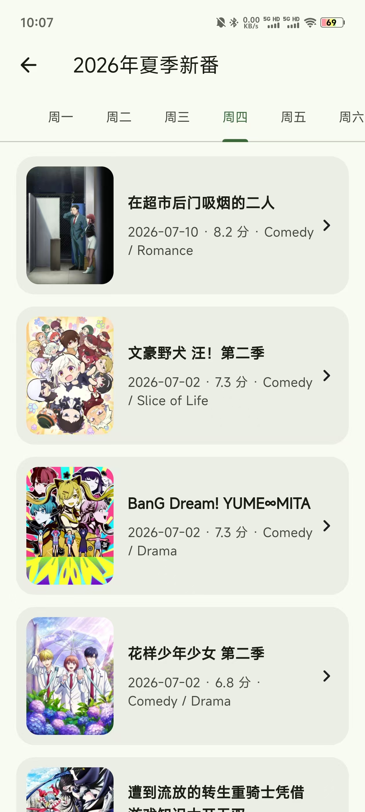
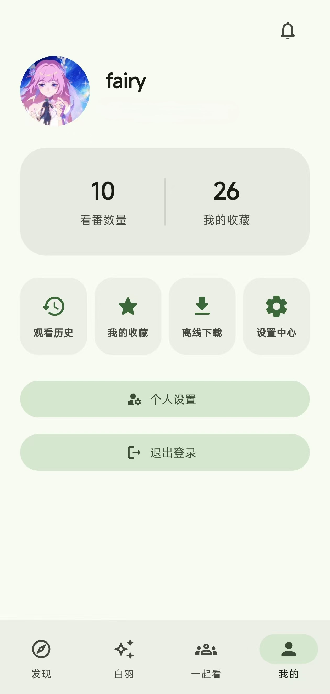
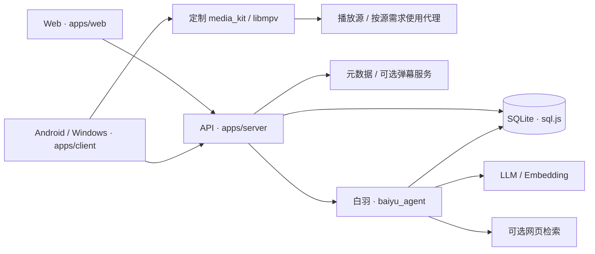

<div align="center">
  
  <h1>AniWorld</h1>
  <p>动漫检索、跨端播放、追番管理与白羽智能助手</p>
  <p>
    
    
    
  </p>
</div>

AniWorld 将网页、Node.js API、白羽 Agent 与基于 [Kazumi](https://github.com/Predidit/Kazumi) 改造的 Flutter 客户端放在同一仓库。既可以通过浏览器使用，也可以将 Android、Windows 客户端连接到自己的服务端。

## 功能与平台

- **发现与检索**：番剧搜索、分类、排行榜、放送日历、详情与角色资料。
- **观看**：选集、多线路解析、观看进度、弹幕；客户端使用定制的 `media_kit` / libmpv 播放器。
- **追番与账户**：注册登录、收藏、追番、观看历史、评论与账户数据同步。
- **白羽 Agent**：站内问答、推荐与比较、知识检索、按需网页查证、工具执行进度和流式回答。
- **记忆**：会话原文、结构化滚动摘要、用户记忆与会话约束管理，修订和遗忘。
- **部署与发布**：元数据同步、RAG 索引、客户端更新接口和 Android / Windows 发布脚本。

| 入口 | 当前仓库的支持范围 |
|---|---|
| Web | 目录、账户、白羽与 API；观看请使用客户端选源 |
| Android | Flutter 客户端，发布脚本构建 arm64 APK |
| Windows | Flutter 桌面客户端，发布脚本生成完整 ZIP |
| 其他平台 | 保留部分上游工程文件，尚未作为本项目的正式发布目标 |

客户端同时具备规则源、下载、外部播放器、投屏、Anime4K 和 WebDAV 等能力。

## 界面预览

<p align="center">
  
  
  
</p>
<p align="center">
  
  
  
</p>

## 使用入口

下载：[Android APK](https://github.com/Yuuki-Asuna233/AniWorld/releases/tag/android-v2.2.10) · [Windows ZIP](https://github.com/Yuuki-Asuna233/AniWorld/releases/tag/windows-v2.2.10)

先部署并启动服务端，再安装客户端，在首次连接页填写服务器地址。安装包默认地址为 `http://127.0.0.1:3000`；手机连接电脑上的服务时，需要改成电脑的局域网 IP。

网页直接访问自己的服务地址。访问门禁默认关闭，需要云端同步追番和观看记录时再注册登录。

**Windows 请完整解压发布包，保留同目录的 DLL、data 和其他运行文件。** 更新时使用完整的新发布包。

本仓库提供自行构建和发布流程，参见 [客户端说明](apps/client/README.md)。服务端更新接口为 `/kazumi/v1/app/latest?platform=android` 或 `platform=windows`，安装包放在部署者配置的发布目录中。

## 第一次使用与自行构建

初次使用推荐先部署服务端并导入仓库附带的番剧目录，安装包的 Release 页面有对应步骤。想自己构建 APK，可按 [从零部署到首次播放](docs/getting-started.md) 继续配置 Flutter、签名和构建环境；直接使用上面的安装包不需要这些工具。

客户端支持 **AGE、DM84、enlie** 三个播放源，可在番剧详情页选择；也可自行扩展播放源。

## 启动服务端

需要 Node.js **20.9+** 和 npm。在仓库根目录执行：

```powershell
git clone https://github.com/Yuuki-Asuna233/AniWorld.git
cd AniWorld
npm ci
npm run setup:env
```

首次运行 `setup:env` 会生成私有 `.env` 和随机密钥，已有配置不会覆盖。公开模板默认关闭访问门禁；手动配置时遵守：

| 配置 | 要求 |
|---|---|
| `JWT_SECRET` | 至少 32 个字符的独立随机密钥 |
| `ACCESS_GATE_ENABLED` | 公开模板为 false；未设置此项的旧部署仍开启门禁 |
| `ACCESS_GATE_PASSWORD` | 开启门禁时必填，恰好 18 个字符，包含大写、小写、数字和符号 |
| `ACCESS_GATE_SECRET` | 开启门禁时必填，至少 32 个字符的另一条随机密钥 |

```powershell
npm run data:import
npm start
```

仓库附带 [番剧目录数据包](data/seed/README.md)，首次部署推荐先进行数据导入，数据范围为2010-2026年番剧数据，需要更早数据的可自行同步。

导入会备份数据库，新增缺少的番剧数据并补齐空字段。先停止已有服务再导入，完成后重新启动；不要让 API 和导入脚本同时写数据库。

浏览器打开 <http://localhost:3000>；开启门禁的服务器需要先输入访问密码。数据保存在 `data/runtime/anime_user.db`，启动 60 秒后开始后台同步近期季度，随后默认每 12 小时更新一次。

LLM、Embedding、SMTP、网页搜索与弹幕凭据为按功能选配；不配置模型仍可使用基础页面，但白羽不会自动替代模型执行完整对话。

完整配置、首次导入、RAG 建索引、构建与生产部署见 [开发与部署指南](docs/development.md)。Windows 与 Linux 均可用 `npm run setup:env` 创建首次配置。

## 系统架构



| 部分 | 实现与职责 |
|---|---|
| Web | 原生 HTML / CSS / JavaScript，消费 API 与 Agent 流式事件 |
| 服务端 | Express 5、CommonJS，负责访问控制、账户、目录与持久化；客户端规则负责播放解析 |
| 数据库 | `sql.js` SQLite、标题 FTS、RAG 分块与 Float32 向量 |
| Agent | 模型原生 Tool Calling、本地工具契约、按需 Skill、上下文预算与记忆 |
| 客户端 | Flutter 3.44.3、MobX、Hive、仓库内播放器依赖 |

数据库由单个进程持有内存快照并落盘。**同一数据库只能由一个服务进程管理；独立同步和索引脚本需要先停止 API。** 生产环境采用单实例部署，不能直接通过 PM2 cluster 共享该数据库文件。

## 白羽 Agent

白羽先使用模型理解本轮的记忆范围、任务切换以及待确认操作，再进入工具循环。工具执行阶段发送进度事件，最终回答阶段流式输出文本。

上下文包括固定规则与技能目录、滚动摘要、未被摘要覆盖的近期原文，以及位于后部的会话状态、用户约束、按需技能和相关记忆、日期与当前用户消息。完整工具定义通过独立的 `tools` 字段发送，并计入预算。页面详情通过 `get_page_context` 按需读取，不在每轮自动注入。

当前有 **23 个工具、3 个 Skill**；游客可用 18 个工具。工具负责明确的查询或操作，Skill 描述推荐、比较与调查的工作流程。记忆语义由模型生成结构化提案，执行层校验提案、目标 ID、版本和授权边界，而不是用固定句式匹配用户意图。

摘要采用“旧结构化摘要 + 新增原文 + 会话状态”重新生成，成功持久化后推进覆盖水位。默认部署预算为 128,000 Token，高低水位为 96,000 / 64,000；实际容量受模型与网关限制。

详细机制、工具职责与核心代码入口见 [Agent README](baiyu_agent/README.md)。

## 项目目录与文档

```text
apps/
  web/                 网页、静态资源与管理页面
  server/              API、数据库、业务服务与中间件
  client/              Flutter Android / Windows 客户端
baiyu_agent/           Agent 编排、工具、技能、记忆与检索
packages/              本地播放器及平台依赖
data/
  runtime/             默认数据库与运行状态
  releases/            发布 APK / Windows ZIP
  uploads/             用户上传资源
scripts/
  data/                数据同步与索引
  release/             客户端构建与发布
tests/                 已有回归检查
docs/                  设计、审计、修复与部署记录
package.json           Node 项目信息、命令与依赖范围
package-lock.json      npm 解析得到的依赖锁定记录
```

- [开发、配置与部署](docs/development.md)
- [公开发行与服务隔离](docs/public-distribution.md)
- [客户端构建与使用](apps/client/README.md)
- [Agent 实现](baiyu_agent/README.md)
- [运行数据与备份](data/runtime/README.md)
- [Agent 可观测性](docs/agent-observability.md)
- [流式输出与工具进度](docs/agent-streaming.md)


公开仓库提供当前实现与使用文档，默认使用本地服务地址，公网部署请填写自己服务器IP。

## 常见问题

**客户端一定需要公网服务器吗？**

不需要。局域网服务也可以使用，但地址必须能从设备访问。手机的 `localhost` 指向手机自身，不能用于连接电脑上的服务；Android 模拟器通常通过 `10.0.2.2` 访问宿主机。公网部署建议使用 HTTPS。

**安装了同一个版本，为什么行为还不同？**

同一个版本号可能对应不同构建，且设备配置、缓存、网络与服务端版本也可能不同。反馈时同时提供平台、安装包来源、服务端地址、播放源、发生时间和错误表现。

**客户端视频都经过服务器代理吗？**

公开版三种规则由客户端查询站点并解析，本地播放器直接加载媒体，通常不占用自建 API 的视频代理带宽。规则站点自身可能还有解析或媒体中转；排查时查看最终媒体地址与请求链路。


**为什么没有模型配置时白羽不能回答？**

白羽需要支持原生 `tool_calls` 的模型服务。网页基础搜索与播放可以独立使用；Embedding 和 Tavily 也分别配置，不等于聊天模型已经可用。

## 依赖文件

`package.json` 描述“项目需要什么”：入口、npm 命令、Node 版本要求和直接依赖的版本范围。`package-lock.json` 描述“npm 实际选中了什么”：直接与间接依赖的具体版本、下载位置和完整性信息。

例如，`express: "^5.2.1"` 允许兼容范围内的版本，而锁文件记录此次解析采用的具体版本。两个文件都应保留并提交；干净安装与部署优先使用 `npm ci`，有意增删或更新依赖时使用相应 npm 命令，并一起检查两份文件的变化。不要手工修改锁文件解决安装报错。参见 [npm 锁文件说明](https://docs.npmjs.com/cli/v11/configuring-npm/package-lock-json/) 和 [npm ci](https://docs.npmjs.com/cli/v11/commands/npm-ci/)。

这两份 JSON 管理 Node 依赖；Flutter 依赖由 `apps/client/pubspec.yaml` 与 `pubspec.lock` 管理，另有本地 `packages/` 依赖。根 `package.json` 的 `1.0.0` 也不是客户端发布版本。

## 反馈与贡献

报告问题时附上平台、构建版本、重现步骤、预期与实际行为；播放问题再附源和线路，Agent 问题再附工具状态。日志、截图和配置中请去除密钥、密码、访问令牌以及带签名的媒体 URL。

修改对应模块时同步更新入口文档；详细过程写入 `docs/`。播放器依赖包含本项目适配，不宜直接用上游包覆盖。

## 致谢与许可证

客户端源自 [Predidit/Kazumi](https://github.com/Predidit/Kazumi)，播放器依赖源自其相关 fork 与 [media-kit](https://github.com/media-kit/media-kit)，元数据与外部能力还依赖 AniList、弹弹 play 等服务。

本仓库包含不同许可证的组件：项目自身的服务端与 Agent 代码使用 [ISC](LICENSE)，[客户端许可证](apps/client/LICENSE)为 GPL-3.0，[media_kit](packages/media_kit/LICENSE)与 [media_kit_video](packages/media_kit_video/LICENSE)保留各自的 MIT 许可证。详见 [组件许可证说明](LICENSING.md)。
